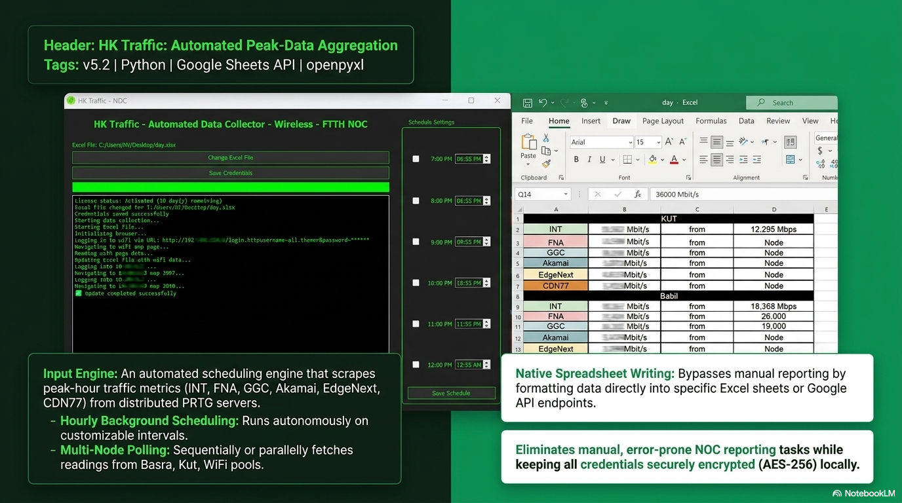
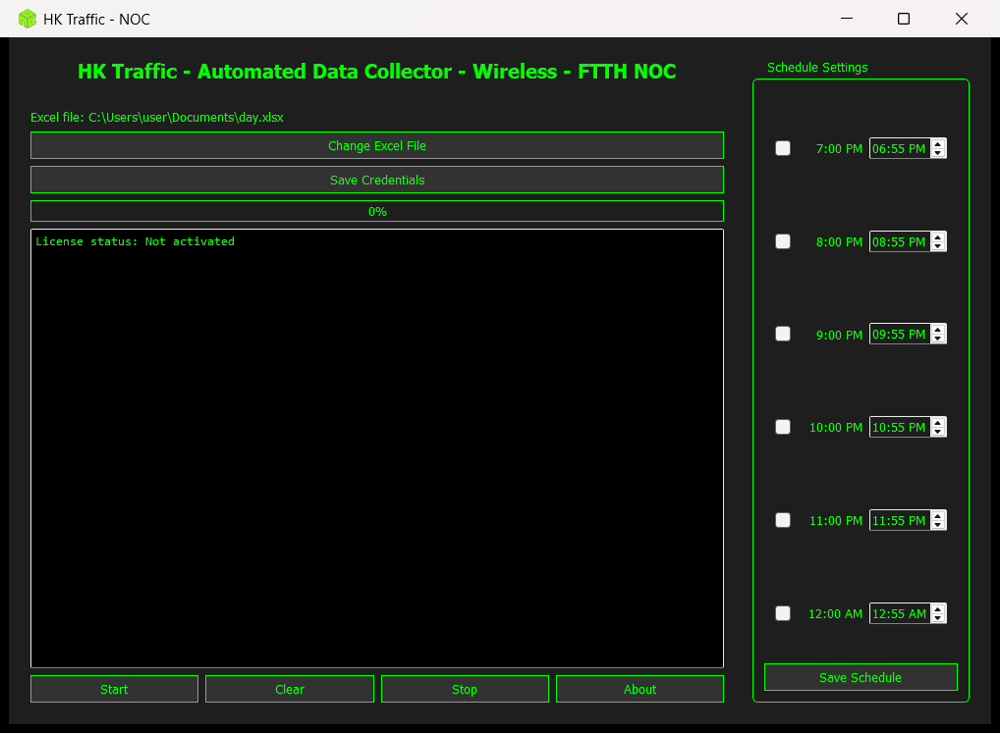

<h1 align="center">HK Traffic - NOC</h1>

<p align="center"><b>Collects traffic graphs from PRTG maps for NOC reporting</b></p>

<p align="center">
  
  
  
  <a href="https://github.com/alisadhk/hk-traffic-noc/releases/latest"></a>
</p>

---

## Overview
A PyQt5 desktop tool for Network Operations Centers. It logs in to PRTG web maps with Selenium for several sites (FTTH and Wi-Fi), reads the traffic values and writes them into an Excel report on a schedule, with sound and desktop notifications.

## Features
- Separate profiles for Basra FTTH, Kut FTTH and Wi-Fi PRTG servers
- Scheduled collection (Schedule Settings)
- Excel output file you can change
- Saved credentials (Save Credentials)
- Start / Stop / Clear controls with a live log
- Activation dialog (trial/licensed mode)
- Aggregates peak-hour traffic metrics (INT, FNA, GGC, Akamai, EdgeNext, CDN77) from distributed PRTG servers
- Hourly background scheduling with customizable intervals
- Writes the results straight into Excel sheets (openpyxl); Google Sheets output is described in the v5.2 project notes
- Credentials are stored encrypted on the local machine

## How it works
- At every scheduled time the tool opens a Chrome session with Selenium and signs in to each PRTG server (Basra, Kut, Wi-Fi pools).
- It opens the configured map ID and reads the traffic values.
- The numbers are written into the matching cells of the Excel file you selected.
- A notification and the live log tell you when the update finished.

## Requirements
- Windows 10/11 and Google Chrome.
- Access to your PRTG servers and a prepared Excel report file.
- Python 3.10+ with PyQt5, Selenium and openpyxl when running from source.

## Screenshots
<p align="center"></p>
<p align="center"></p>

## Download and install
### Option A - Ready-to-run download (recommended)
1. Open the **[Releases page](https://github.com/alisadhk/hk-traffic-noc/releases/latest)**.
2. Download the file(s) listed under **Assets**:

| File | Size |
|---|---|
| `HK-Traffic-NOC.exe` | 71.6 MB |

3. Run it. 

### Option B - Run from source
Requirements: Windows 10/11 and Python 3.10+.

```bash
git clone https://github.com/alisadhk/hk-traffic-noc.git
cd hk-traffic-noc
python -m pip install -r requirements.txt
python 111.py
```

## How to use
1. Start the program.
2. For each site enter the PRTG **IP**, **Map ID**, **Username** and **Password** (or the Wi-Fi username/password).
3. Pick the Excel file with **Change Excel File**.
4. Optionally set the schedule in **Schedule Settings** and press **Save Schedule**.
5. Press **Start**. Watch the log; press **Stop** to end the run.

## Configuration and privacy
- All sensitive values from the original private version (passwords, tokens, license codes, user names, internal IP addresses, personal names and links) were replaced with `*****`.
- The built-in license code and signing key are masked (`*****`). Put your own values in 111.py (LicenseManager) before building a licensed version, or use the trial mode.
- Default IP/user/password fields are empty placeholders; type your own values in the UI.

## Troubleshooting
- Nothing is written: confirm the Excel file is closed and the path is correct.
- Login errors: re-enter the IP, map ID and credentials for that site.
- Schedule does not fire: tick the time slot and press **Save Schedule**.

## Build the executable yourself
```bash
python -m pip install pyinstaller
python -m PyInstaller --noconfirm 111.spec
```
The executable is created in the `dist/` folder.

## Notes
- Needs Google Chrome installed (Selenium Manager downloads the matching driver).
- Network maps, IDs and addresses from the original deployment are not published.

---

<p align="center">Maintained by <a href="https://github.com/alisadhk">@alisadhk</a> - last update 2025-10-24</p>